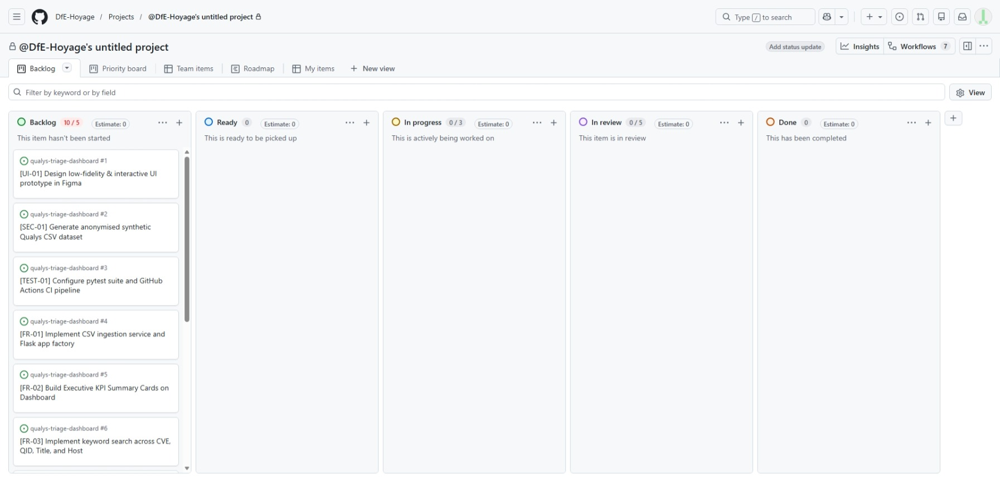
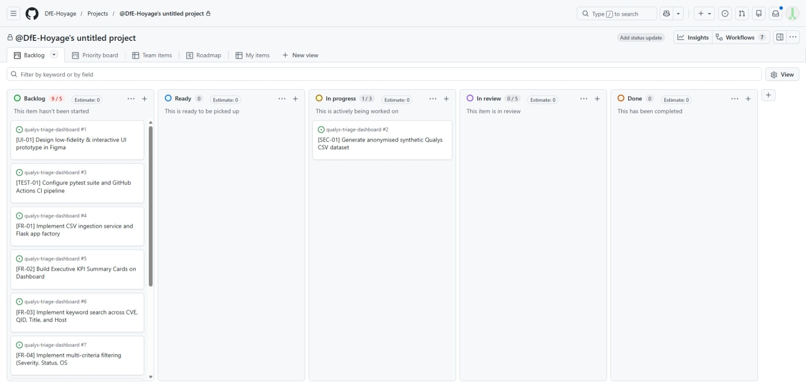
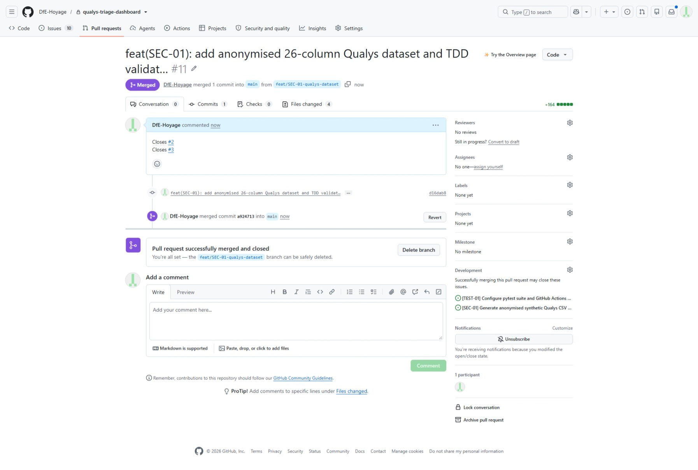

#### Functional Requirements (FR)

| ID | Requirement | Acceptance Criteria | Priority |
| :--- | :--- | :--- | :--- |
| **FR-01** | **Anonymised Qualys CSV Ingestion** | The system parses the 26-column Qualys VMDR CSV schema (`Service Type`, `Service Offering`, `Private IP`, `Public IP`, `PowerState`, `DNS Name`, `Server Name`, `QID`, `QDS Level`, `Vulnerability Name`, `ARS Level`, `Last Detected`, `QDS`, `ARS`, `Vuln Status`, `FQDN`, `SSL`, `Port`, `Protocol`, `CVE ID`, `Vendor Reference`, `Solution`, `Results`, `Type`, `OS`, `Category`) without errors. | Must Have |
| **FR-02** | **Executive KPI Summary Cards** | The main dashboard displays live aggregated counts for Total Findings, Critical (`QDS Level: Critical`), High (`QDS Level: High`), and Active/Unpatched (`New`, `Active`, `Re-Opened`) vulnerabilities. | Must Have |
| **FR-03** | **Keyword Search** | Users can search vulnerabilities by keyword across `CVE ID`, `QID`, `Vulnerability Name`, `Server Name`, `Private IP`, and `Category` fields with case-insensitive matching. | Must Have |
| **FR-04** | **Multi-Criteria Filtering** | Users can filter the vulnerability table simultaneously by `QDS Level` (`Critical`, `High`, `Medium`, `Low`), `Vuln Status` (`New`, `Active`, `Re-Opened`, `Fixed`), `Service Offering`, and `OS`. | Must Have |
| **FR-05** | **Vulnerability Remediation Detail View** | Clicking any finding opens a dedicated detail page (`/vulnerability/<id>`) displaying full `QDS`/`ARS` scores, affected asset metadata (`Server Name`, `FQDN`, `Private IP`, `Port`, `Protocol`), detection `Results`, and recommended `Solution` steps. | Should Have |
| **FR-06** | **Filtered CSV Export** | Users can export their currently filtered subset of vulnerabilities back to a sanitised CSV file (`qualys_filtered_export.csv`) for remediation ticket assignment. | Could Have |

#### Non-Functional Requirements (NFR)

| ID | Requirement | Target / Metric |
| :--- | :--- | :--- |
| **NFR-01** | **Performance & Responsiveness** | Search and filter queries execute and update the UI in under `500 ms` for datasets up to `2,000` rows. |
| **NFR-02** | **Usability & Accessibility** | Responsive layout usable on desktop and laptop screens (`1280px+`), using colour-coded severity badges alongside text labels for colour-blind accessibility. |
| **NFR-03** | **Maintainability & Modularity** | Codebase separates presentation (`frontend/`), API logic (`backend/`), business/data logic (`services/`), and automated tests (`tests/`). |
| **NFR-04** | **Availability & Hosting** | Application is deployed publicly on a zero-cost platform (Render) with automated builds triggered from the `main` branch. |

#### Security Requirements (SEC)

| ID | Requirement | Implementation Control |
| :--- | :--- | :--- |
| **SEC-01** | **Data Anonymisation & Privacy** | All real internal IP addresses, DNS hostnames, and organizational identifiers are scrubbed/replaced with RFC 5737 documentation IPs and synthetic hostnames prior to ingestion. |
| **SEC-02** | **Session-Based Authentication** | Protected dashboard routes require valid user login via Flask session management (`services/auth.py`) with hashed passwords (`werkzeug.security`). |
| **SEC-03** | **XSS & CSV Formula Injection Prevention** | All dynamic CSV fields are auto-escaped via Jinja2 templates, and exported CSV cells starting with `=`, `+`, `-`, or `@` are sanitised. |
| **SEC-04** | **Secrets Management** | Flask `SECRET_KEY` and demo credentials are loaded via environment variables (`.env` excluded via `.gitignore`) rather than hardcoded in source control. |

### Project Tracking & CI/CD Evidence

_complete.jpeg)
