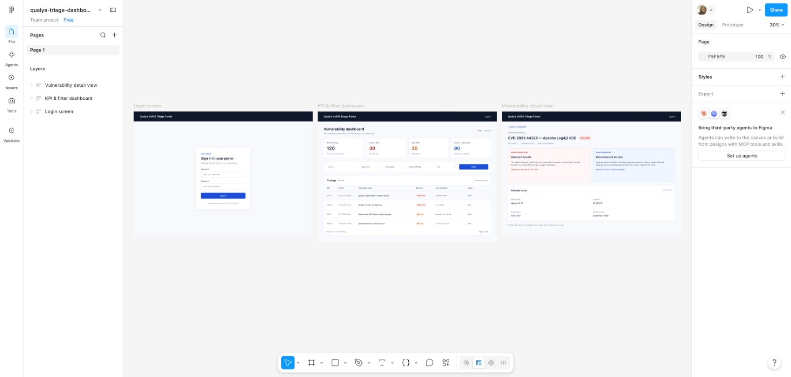
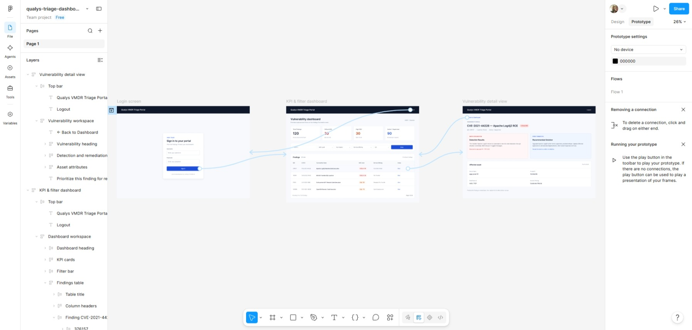
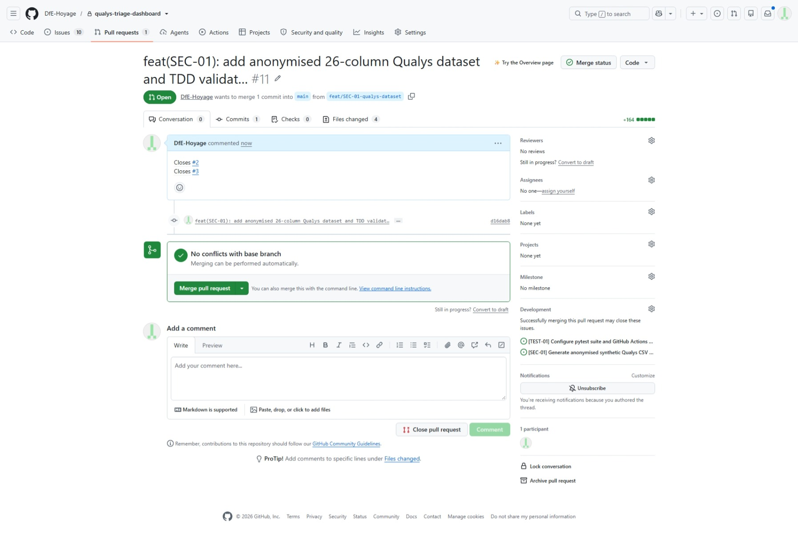
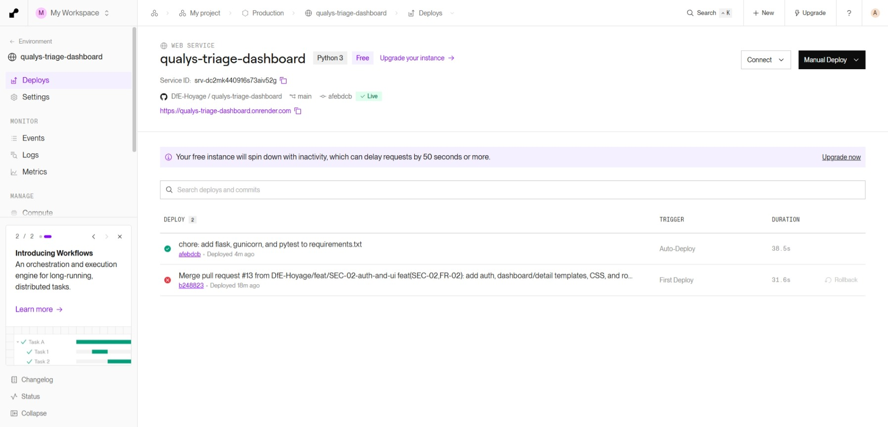
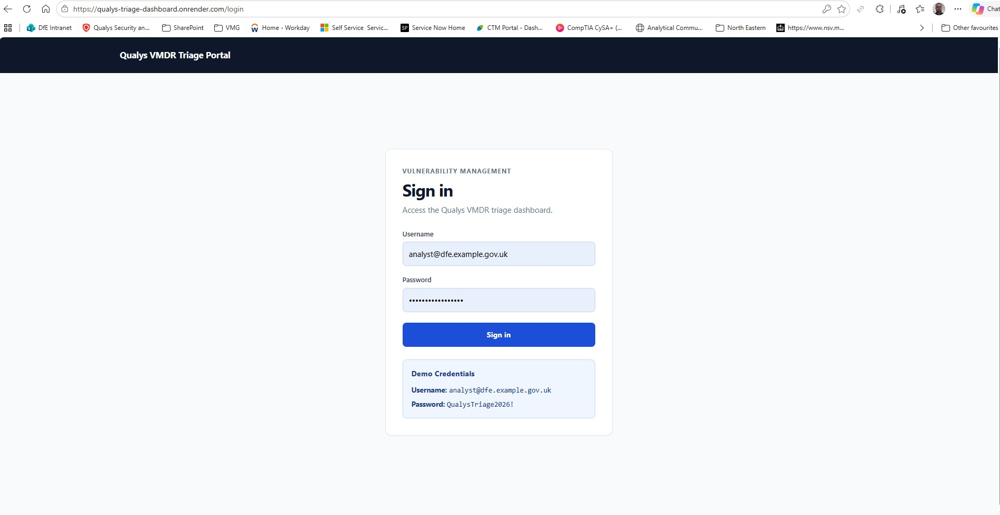
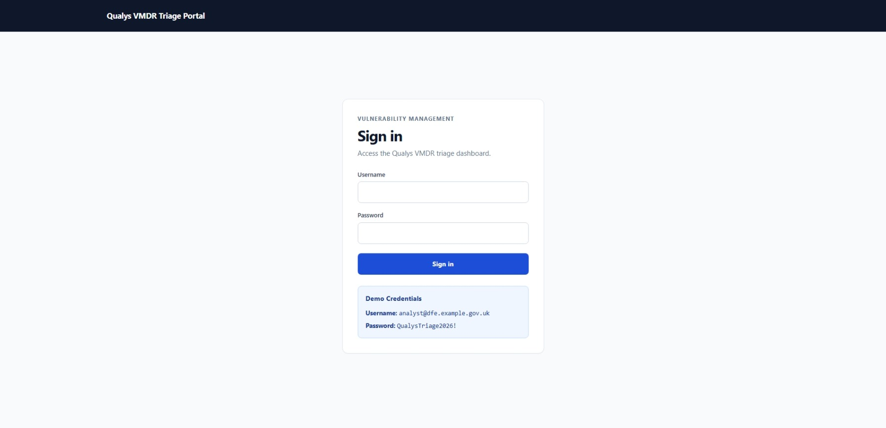
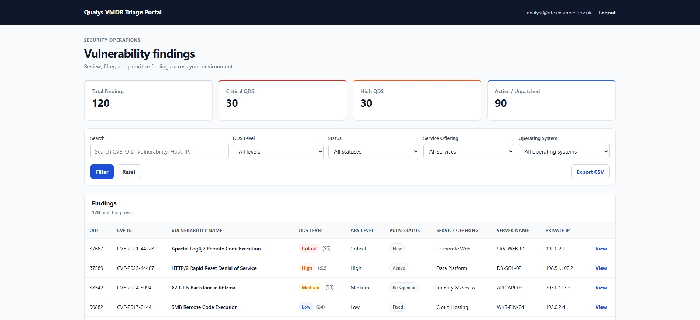
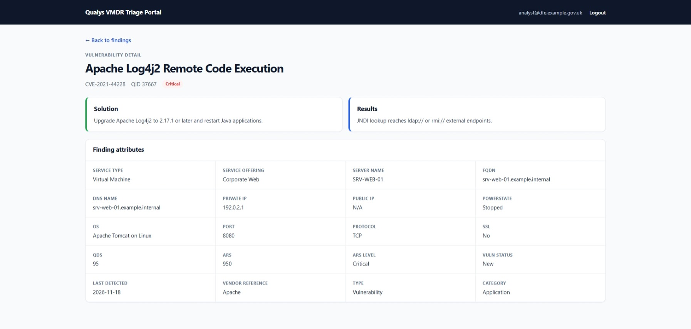

# Qualys VMDR Triage Portal

**Live Application URL:** [https://qualys-triage-dashboard.onrender.com](https://qualys-triage-dashboard.onrender.com)
**Demo Login Credentials:**  
* **Username:** `analyst@dfe.example.gov.uk`  
* **Password:** `QualysTriage2026!`  

*(Note: The application is hosted on Render's zero-cost free tier. If the instance has been idle for more than 15 minutes, the first request may take 30–45 seconds to wake up before loading normally.)*

---

## 1. Product Proposal & Business Case

### Organisational Context
Within the **Department for Education (DfE)** Cyber Security & Infrastructure Operations function, vulnerability management teams routinely conduct authenticated and external scans using **Qualys VMDR (Vulnerability Management, Detection and Response)**. Scan outputs are regularly exported as large, 26-column CSV spreadsheets containing hundreds of findings across multiple cloud workloads, virtual machines, identity services, and web applications.

### Problem Statement
Currently, security analysts and service-line engineers triage raw Qualys CSV exports manually in spreadsheet software. Filtering simultaneously across multiple operational attributes—such as **Qualys Detection Score (`QDS Level`)**, **Asset Risk Score (`ARS Level`)**, **Service Offering**, **Operating System**, and **Vulnerability Status**—is slow, error-prone, and makes isolating actionable remediation guidance (`Solution` and `Results`) cumbersome during patching cycles.

### Proposed Solution & Expected Benefits
The **Qualys VMDR Triage Portal** is a lightweight, authenticated web application designed to ingest the organisation's 26-column Qualys CSV schema and present it through an interactive triage interface.
* **Accelerated Risk Prioritisation:** Executive KPI summary cards immediately highlight Critical/High QDS risks and active unpatched findings.
* **Multi-Criteria Triage & Search:** Engineers can filter simultaneously by `QDS Level`, `Vuln Status`, `Service Offering`, and `OS`, or search across `CVE ID`, `QID`, `Vulnerability Name`, `Server Name`, and `Private IP`.
* **Actionable Remediation & Ticket Export:** Individual finding pages surface exact detection `Results` and vendor `Solution` steps, while filtered subsets can be exported to sanitised CSVs for remediation ticket assignment.

---

## 2. UI Design & Prototyping (Figma)

Low-fidelity and interactive wireframes were designed in **Figma** prior to frontend implementation to establish visual hierarchy, colour-coded severity pills (paired with text labels for accessibility), and user navigation across three core screens: **Login Screen**, **KPI & Filter Dashboard**, and **Vulnerability Detail View**.

### Figma Design Frames


### Interactive Prototype Flow


---

## 3. Requirements Specification

### Functional Requirements (FR)

| ID | Requirement | Acceptance Criteria | Priority |
| :--- | :--- | :--- | :--- |
| **FR-01** | **Anonymised Qualys CSV Ingestion** | The system parses the 26-column Qualys VMDR CSV schema (`Service Type`, `Service Offering`, `Private IP`, `Public IP`, `PowerState`, `DNS Name`, `Server Name`, `QID`, `QDS Level`, `Vulnerability Name`, `ARS Level`, `Last Detected`, `QDS`, `ARS`, `Vuln Status`, `FQDN`, `SSL`, `Port`, `Protocol`, `CVE ID`, `Vendor Reference`, `Solution`, `Results`, `Type`, `OS`, `Category`) without errors. | Must Have |
| **FR-02** | **Executive KPI Summary Cards** | The main dashboard displays live aggregated counts for Total Findings, Critical (`QDS Level: Critical`), High (`QDS Level: High`), and Active/Unpatched (`New`, `Active`, `Re-Opened`) vulnerabilities. | Must Have |
| **FR-03** | **Keyword Search** | Users can search vulnerabilities by keyword across `CVE ID`, `QID`, `Vulnerability Name`, `Server Name`, `Private IP`, and `Category` fields with case-insensitive matching. | Must Have |
| **FR-04** | **Multi-Criteria Filtering** | Users can filter the vulnerability table simultaneously by `QDS Level` (`Critical`, `High`, `Medium`, `Low`), `Vuln Status` (`New`, `Active`, `Re-Opened`, `Fixed`), `Service Offering`, and `OS`. | Must Have |
| **FR-05** | **Vulnerability Remediation Detail View** | Clicking any finding opens a dedicated detail page (`/vulnerability/<id>`) displaying full `QDS`/`ARS` scores, affected asset metadata (`Server Name`, `FQDN`, `Private IP`, `Port`, `Protocol`), detection `Results`, and recommended `Solution` steps. | Should Have |
| **FR-06** | **Filtered CSV Export** | Users can export their currently filtered subset of vulnerabilities back to a sanitised CSV file (`qualys_filtered_export.csv`) for remediation ticket assignment. | Could Have |

### Non-Functional Requirements (NFR)

| ID | Requirement | Target / Metric |
| :--- | :--- | :--- |
| **NFR-01** | **Performance & Responsiveness** | Search and filter queries execute and update the UI in under `500 ms` for datasets up to `2,000` rows. |
| **NFR-02** | **Usability & Accessibility** | Responsive layout usable on desktop and laptop screens (`1280px+`), using colour-coded severity badges alongside text labels for colour-blind accessibility. |
| **NFR-03** | **Maintainability & Modularity** | Codebase separates presentation (`frontend/`), API logic (`backend/`), business/data logic (`services/`), and automated tests (`tests/`). |
| **NFR-04** | **Availability & Hosting** | Application is deployed publicly on a zero-cost platform (Render) with automated builds triggered from the `main` branch. |

### Security Requirements (SEC)

| ID | Requirement | Implementation Control |
| :--- | :--- | :--- |
| **SEC-01** | **Data Anonymisation & Privacy** | All real internal IP addresses, DNS hostnames, and organisational identifiers are scrubbed/replaced with RFC 5737 documentation IPs (`192.0.2.0/24`, `198.51.100.0/24`, `203.0.113.0/24`) and synthetic hostnames prior to ingestion. |
| **SEC-02** | **Session-Based Authentication** | Protected dashboard routes require valid user login via Flask session management (`services/auth.py`) with hashed passwords (`werkzeug.security`). |
| **SEC-03** | **XSS & CSV Formula Injection Prevention** | All dynamic CSV fields are auto-escaped via Jinja2 templates, and exported CSV cells starting with `=`, `+`, `-`, or `@` are sanitised. |
| **SEC-04** | **Secrets Management** | Flask `SECRET_KEY` and demo credentials are loaded via environment variables (`.env` excluded via `.gitignore`) rather than hardcoded in source control. |

---

## 4 & 5. Project Tickets & Kanban Board Tracking

Requirements were decomposed into 10 granular **GitHub Issues** (`[UI-01]`, `[SEC-01]`, `[TEST-01]`, `[FR-01]`–`[FR-05]`, `[SEC-02]`, `[DOCS-01]`), categorised with colour-coded labels (`feature`, `security`, `testing`, `ui-ux`, `docs`, `must-have`, `should-have`), and tracked iteratively across a **GitHub Projects Kanban board** (`To Do`, `In Progress`, `In Review`, `Done`).

### Initial Backlog Setup


### Active Sprint Execution


---

## 6. Incremental MVP Development & Code Quality

The MVP was developed incrementally across four structured stages, separating presentation (`frontend/`), REST JSON endpoints (`backend/`), data/security services (`services/`), and automated test suites (`tests/`):

1. **Stage 1 — Repository Skeleton & CI Configuration:** Established modular Flask Blueprints, `.gitignore`, `requirements.txt`, and `.github/workflows/ci.yml`.
2. **Stage 2 — Synthetic Dataset & Schema Validation (`SEC-01`):** Generated a 120-row dataset matching the exact 26-column production Qualys schema with accurate `QDS`/`ARS` correlations and RFC 5737 documentation IPs.
3. **Stage 3 — Core Data & Filtering Engine (`FR-01`–`FR-04`):** Implemented `services/vuln_service.py` using UTF-8 BOM-safe CSV parsing (`utf-8-sig`) and multi-criteria filtering.
4. **Stage 4 — Session Authentication, Web UI & Export (`SEC-02`, `FR-05`, `FR-06`):** Built Jinja2 templates (`login.html`, `dashboard.html`, `vuln_detail.html`), REST endpoints (`/api/vulnerabilities`), and CSV formula-injection sanitisation.

### Selected Code Snippets

**Multi-Criteria Filtering (`services/vuln_service.py`):**
```python
def filter_vulnerabilities(
    records: List[Dict[str, Any]],
    query: str = "",
    qds_level: str = "",
    status: str = "",
    service_offering: str = "",
    os_name: str = "",
) -> List[Dict[str, Any]]:
    """Filter vulnerability records using case-insensitive keyword search and multi-criteria dropdowns."""
    q = query.strip().lower()
    level_f = qds_level.strip().lower()
    status_f = status.strip().lower()
    service_f = service_offering.strip().lower()
    os_f = os_name.strip().lower()

    results: List[Dict[str, Any]] = []
    for row in records:
        if level_f and row.get("QDS Level", "").lower() != level_f:
            continue
        if status_f and row.get("Vuln Status", "").lower() != status_f:
            continue
        if service_f and row.get("Service Offering", "").lower() != service_f:
            continue
        if os_f and row.get("OS", "").lower() != os_f:
            continue
        if q:
            searchable = " ".join([
                row.get("QID", ""), row.get("CVE ID", ""),
                row.get("Vulnerability Name", ""), row.get("Server Name", ""),
                row.get("Private IP", ""), row.get("Category", ""),
            ]).lower()
            if q not in searchable:
                continue
        results.append(row)
    return results
```

**CSV Formula Injection Sanitisation (`frontend/routes.py`):**
```python
def _sanitise_csv_cell(value: str) -> str:
    """SEC-03: Prevent CSV formula injection (=, +, -, @)."""
    text = str(value or "")
    if text and text in ("=", "+", "-", "@"):
        return f"'{text}"
    return text
```

---

## 7. Test-Driven Development (TDD) & CI/CD Pipeline

### Test-Driven Development (`pytest`)
Unit and integration tests were authored in `tests/test_vuln_service.py` and `tests/test_routes.py` prior to implementing service and route logic:
* **Schema & Privacy Validation (`SEC-01`):** Verifies the CSV matches all 26 Qualys headers and validates every `Private IP` and `Public IP` via Python's `ipaddress` module to guarantee only RFC 5737 ranges are present.
* **Service Logic Tests (`FR-01`–`FR-04`):** Validates KPI totals (`120` total, `30` Critical, `30` High, `90` Active/Unpatched) and combined keyword/dropdown filtering.
* **Route & Security Tests (`SEC-02`, `FR-05`, `FR-06`):** Tests unauthenticated redirects (`302` to `/login`), authenticated dashboard access, `404` handling on invalid vulnerability IDs, and CSV download headers.

### Automated CI/CD Evidence (GitHub Actions)
Every push and Pull Request targeting `main` triggers `.github/workflows/ci.yml`, which provisions Ubuntu, installs `requirements.txt`, and executes `pytest -v`.



_complete.jpeg>)
_complete.jpeg>)

---

## 8. Version Control & Live Deployment

Development followed an incremental feature-branch workflow (`feat/SEC-01-qualys-dataset`, `feat/FR-01-vuln-service`, `feat/SEC-02-auth-and-ui`) merged via Pull Requests into `main`. Merging into `main` automatically deploys the production application to **Render** using Gunicorn (`gunicorn app:app`).

* **Live Application URL:** [https://qualys-triage-dashboard.onrender.com](https://qualys-triage-dashboard.onrender.com)

### Render Deployment & Live Application Evidence



### Live User Interface Views




---

## 9. User & Technical Documentation

### User Documentation
1. **Sign In:** Navigate to [https://onrender.com](https://onrender.com) and enter the demo credentials (`analyst@dfe.example.gov.uk` / `QualysTriage2026!`).
2. **Review Executive KPIs:** The top summary bar displays total findings alongside Critical QDS, High QDS, and Active/Unpatched counts.
3. **Search & Filter:** Enter keywords (e.g., `Log4j2`, `CVE-2024`, `SRV-WEB-01`) into the search box and combine dropdown filters (`QDS Level`, `Vuln Status`, `Service Offering`, `OS`), then click **Filter**. Click **Reset** to clear all filters.
4. **Inspect Remediation Details:** Click **View** on any row to inspect the full 26-field asset profile, detection `Results`, and vendor `Solution`.
5. **Export Filtered Results:** Click **Export CSV** to download `qualys_filtered_export.csv` containing only the currently filtered records.

### Technical Documentation

#### Architecture & Directory Structure
```text
qualys-triage-dashboard/
├── .github/workflows/ci.yml       # GitHub Actions pytest pipeline
├── backend/routes.py              # REST JSON API (/api/vulnerabilities)
├── frontend/routes.py             # Web UI routes, auth views & CSV export
├── services/
│   ├── auth.py                    # Session auth & Werkzeug password hashing
│   └── vuln_service.py            # CSV ingestion, KPI aggregation & filtering
├── templates/                     # Jinja2 templates (base, login, dashboard, detail)
├── static/css/style.css           # Responsive enterprise stylesheet
├── data/qualys_vulnerabilities.csv# 26-column anonymised Qualys dataset
├── tests/                         # Pytest unit and integration test suites
├── app.py                         # Flask application factory
└── requirements.txt               # Python dependencies (flask, gunicorn, pytest)
```

#### Local Setup & Running Tests
```bash
# 1. Clone the repository
git clone https://github.com
cd qualys-triage-dashboard

# 2. Create and activate a virtual environment
python -m venv .venv
# Windows PowerShell: .\.venv\Scripts\Activate.ps1
# macOS/Linux: source .venv/bin/activate

# 3. Install dependencies
pip install -r requirements.txt

# 4. Run the automated pytest suite
pytest -v

# 5. Start the local Flask server
flask run
```

---

## 10. Product Evaluation

### Requirements Traceability & Strengths
* **Full Requirement Coverage:** All `Must Have` and `Should Have` functional requirements (`FR-01`–`FR-06`) and security controls (`SEC-01`–`SEC-04`) were delivered and verified through automated `pytest` suites.
* **Production Schema Alignment:** Designing directly against the organisation's 26-column Qualys VMDR export format ensures immediate operational applicability without schema translation overhead.
* **Privacy-by-Design & DevSecOps:** Enforcing RFC 5737 IP validation within automated CI tests prevents accidental exposure of internal infrastructure data, while GitHub Actions blocks broken code from reaching `main`.

### Limitations & Future Enhancements
* **Static CSV Snapshot vs. Live Qualys API:** The current MVP ingests a static CSV file rather than polling the Qualys VMDR API directly. Future iterations would add scheduled API ingestion or an authenticated web-based CSV upload form with schema validation.
* **Single-User Demo Authentication:** Authentication currently validates against a single environment-configured analyst account (`services/auth.py`). Scaling to production would integrate Microsoft Entra ID (Azure AD) Single Sign-On and role-based access control (RBAC) scoped by `Service Offering`.
* **Free-Tier Hosting Cold Starts:** Render's free tier suspends inactive containers after 15 minutes, introducing a ~30–45 second cold-start delay on initial requests.
